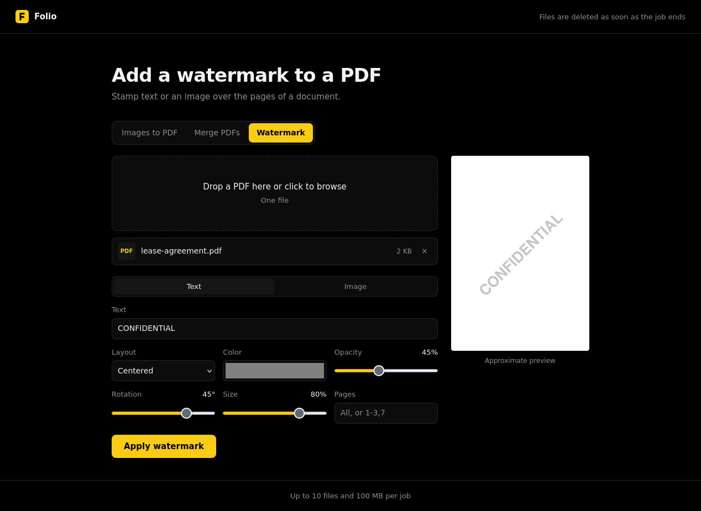

# Folio

Folio is a small self-hosted web app for everyday PDF work:

- combine images into a single PDF
- merge several PDFs into one
- apply a text or image watermark to a PDF

It is written in Go and ships as one static binary with the frontend embedded.
There is no database and no account system. Uploaded files only exist while
their job runs and are deleted right after.



## Deployment

You need Docker with the compose plugin.

Copy the example compose file, then adjust its environment variables if needed:

```
cp docker-compose.example.yaml docker-compose.yaml
```

Build and start the service:

```
docker compose up -d --build
```

Then open http://localhost:8080

To update, pull the new sources and run the same command again.

Without compose:

```
docker build -t folio .
docker run -d -p 8080:8080 folio
```

Folio does not handle TLS or authentication. For a public deployment, put it
behind a reverse proxy that terminates HTTPS, and add rate limiting or access
control there. The proxy upload limit must be at least MAX_UPLOAD_MB.

Large uploads are spooled to /tmp while a job runs. The example compose file
mounts it as a 1 GB tmpfs, which counts as memory. It should hold about
MAX_UPLOAD_MB times the number of simultaneous uploads you expect.

## Environment variables

All variables are optional. An invalid value stops the app at startup.

- PORT: port the HTTP server listens on. Default: 8080
- MAX_UPLOAD_MB: maximum total size of one upload, in megabytes. Default: 100
- MAX_FILES: maximum number of files in one job. Default: 50
- MAX_CONCURRENT_JOBS: jobs processed at the same time. Others wait, then get a
  503 once JOB_TIMEOUT_SECONDS has passed. Default: number of CPU cores
- JOB_TIMEOUT_SECONDS: time allowed for a job, including the wait for a free
  slot. Default: 60
- MAX_IMAGE_MEGAPIXELS: maximum size of one image, in megapixels. Default: 100

## Limitations

- Password protected PDFs are rejected.
- Watermark text is limited to Latin characters, because it uses a built-in PDF
  font. Use an image watermark for anything else.
- A watermark is drawn over the page content and can be removed with PDF
  editing tools. It is a visual mark, not a security feature.

## Development

Requires Go 1.26 or later.

```
go test ./...
go run .
```

The API is plain multipart POST and returns the PDF directly, or a JSON object
with an error field:

```
POST /api/images-to-pdf   files, page_size, orientation, margin
POST /api/merge           files
POST /api/watermark       files, text or image, color, opacity, rotation,
                          size, layout, pages
```

Example:

```
curl -F files=@report.pdf -F text=DRAFT -F layout=tiled -F size=0.3 \
  http://localhost:8080/api/watermark -o report-draft.pdf
```

GET /healthz answers 204 when the server is up.
